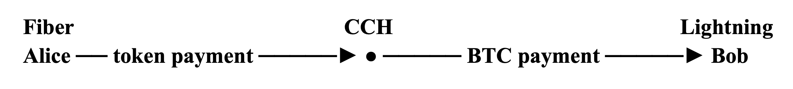

比特币闪电网络率先大规模应用了支付通道（payment channels）。参与者可以通过通道反复进行[链下支付](https://www.nervos.org/knowledge-base/how_off_chain_payments_work)，而通道的开启、关闭和最终结算则依赖区块链。这样，频繁的小额支付就无需将每笔转账都记录在底层链上。

但让支付快速、低成本，只解决了部分问题。一个实用的支付网络可能还需要支持不同资产。

Alice 可能用比特币支付某项服务，在接受美元稳定币的商家处购物，又在某个应用中使用另一种代币。要支持这些支付，光是识别不同资产还不够。网络还需要能够对支付进行路由（routing），提供充足的[通道流动性（channel liquidity）](https://www.nervos.org/knowledge-base/how_liquidity_works_in_the_lightning_network)，并确保最终能在链上结算正确的资产。

这引出了几个架构问题：

每条通道持有哪种资产？收款方希望收到哪种资产？哪些通道可以承载这种资产？支付路径中能否将一种资产转换为另一种？通道关闭时，最终余额又如何在链上结算？

不同的支付网络给出了不同的答案。

**Taproot Assets** 和 **RGB** 通过额外的系统来表示和转移非 BTC 资产，从而扩展比特币和闪电网络生态。**Fiber Network** 则构建在 CKB 上。在 CKB 中，用户自定义资产本身就以具有一等地位的链上状态存在，可以直接用作支付通道的计价资产。

这些不同的起点，带来了多资产支付方式上的实质差异。

## 将闪电网络扩展到 BTC 之外

闪电网络最初围绕以 BTC 计价的支付通道设计。因此，要支持另一种资产，就需要一个额外的系统来识别该资产、证明其所有权，并跟踪支付沿通道传递时的余额变化。

Taproot Assets 和 RGB 都提供了这层额外的资产系统，但它们与闪电网络集成的方式不同。

### Taproot Assets 与边缘转换

Taproot Assets 是一个在比特币上发行和转移资产的协议。它不直接把完整的资产历史放到链上，而是在比特币交易中记录密码学承诺（cryptographic commitments）。这些承诺使 Taproot Assets 软件能够验证，对应的链下资产记录是否与锚定到比特币上的内容一致。

实际运行时，比特币继续验证普通的比特币交易，而 Taproot Assets 软件负责额外的逻辑：识别资产、验证所有权历史，以及跟踪转移。

要将 Taproot Assets 接入更广泛的闪电网络，支付可以经过**边缘节点（Edge Nodes）**。边缘节点位于 Taproot Asset 通道与普通 BTC 闪电网络流动性之间，负责两者之间的转换。

例如：

**Alice ── 稳定币通道 ──► 边缘节点 ── BTC 闪电网络 ──► Bob**

Alice 可以通过 Taproot Asset 通道向边缘节点发送稳定币。边缘节点随后将这部分价值转换为 BTC，再通过普通闪电通道转发支付。

如果 Bob 接受 BTC，支付到这里就可以完成。如果 Bob 想要另一种受支持的资产，收款侧的边缘节点可以再次转换这笔 BTC 支付，然后交付给他。

这意味着路由中间部分不需要承载原始资产。支付的大部分路程可以经过现有的 BTC 闪电通道，转换则发生在网络边缘。

这种模型不要求每个中间闪电节点都理解或持有 Alice 发送的资产。代价是，边缘节点必须提供足够的转换流动性，并确定汇率。Taproot Assets 使用 **询价（Request for Quote，RFQ）** 机制，在支付继续进行之前获取价格。

因此，在 Taproot Assets 模型中，支付路径的不同部分可以承载不同资产：边缘部分使用资产代币，中间通过闪电网络的部分使用 BTC，目的地还可能使用另一种资产。

### RGB 与专用代币通道

RGB 采取了不同的方式。它是一个面向比特币的智能合约协议，允许定义和转移资产及其他状态，而无需比特币节点验证这些额外逻辑。

RGB 使用的是**客户端验证（client-side validation）**。相关各方自行保存并验证有关合约历史，比特币则提供交易历史和密码学承诺，将这些记录锚定下来。

为了在支付通道中使用 RGB 资产，RGB Lightning Node 实现扩展了闪电网络软件，让通道能够在跟踪其比特币状态的同时，跟踪 RGB 代币余额。RGB 资产的变化与通道的闪电承诺交易（commitment transactions）关联；这些交易表示通道最新的、可强制执行的状态。

这使得以 RGB 资产计价的支付可以经过多条兼容的通道：

**Alice ── Token A 通道 ──► 兼容 RGB 的节点 ── Token A 通道 ──► Bob**

与上面的 Taproot Assets 示例不同，Token A 不需要在路径中间转换为 BTC。从发送方到接收方，它可以始终保持为 Token A。

代价是，沿途每条通道都必须支持这种 RGB 资产，并在正确方向上有足够的 Token A 流动性来转发支付。因此，相比中间部分可以使用普通 BTC 闪电网络流动性的 Taproot Assets 模型，这种路径更依赖具体资产。

RGB Lightning Node 实现目前处于早期 alpha 阶段，已有测试网络上的测试记录。

Taproot Assets 和 RGB 展示了将闪电网络扩展到 BTC 之外的两种不同方式。Taproot Assets 可以在边缘进行资产与 BTC 之间的转换，让路径中间部分使用普通闪电网络流动性。RGB 则可以让资产在整条路径中保持不变，前提是每条参与通道都支持该资产。

## Fiber Network 的原生多资产模型

Fiber Network 的基础有所不同。它构建在 Nervos CKB 上，而用户自定义代币在 CKB 中本就以链上资产存在，并有自己的验证规则。

Fiber 将这种资产模型带入支付通道。通道可以使用 CKB 或受支持的用户自定义代币作为计价资产开启，让不同资产使用相同的底层通道协议，无需先通过独立的资产层来表示。

这就是 Fiber **原生支持多资产**的含义：网络的通道模型从设计上就能使用底层链上已经存在的资产。

Fiber 还通过其 **跨链枢纽（Cross-Chain Hub，CCH）** 连接比特币闪电网络。这些能力共同构成了 Fiber 多资产功能的两个不同部分：在 Fiber 通道内原生支持基于 CKB 的资产，以及连接 Fiber 支付与闪电网络 BTC 支付的机制。

*如需更全面地了解 Fiber 架构，请参阅*[*什么是 Fiber？下一代支付网络完整指南*](https://www.nervos.org/knowledge-base/what_is_fiber)。

### 通过 Cell 模型赋予代币一等地位

这一能力的基础是 CKB 的 **Cell 模型**。

[Cell](https://docs.nervos.org/docs/tech-explanation/cell) 是 CKB 用于存储资产和其他状态的基本单元。每个 Cell 都可以包含数据，以及规定这些状态如何使用的脚本。 **锁定脚本（lock script）** 控制谁有权花费 Cell， **类型脚本（type script）** 则可以对其中的内容施加额外规则。

对于用户自定义代币，类型脚本负责识别资产并执行其规则，而 Cell 的数据则记录数量。

这意味着，资产在进入 Fiber 通道之前，就已经具有协议层面的身份。例如，两种稳定币可能都代表一美元，但不同的类型脚本会将它们识别为规则不同的两种独立资产。

为 Fiber 通道注入用户自定义代币时，注资交易（funding transaction）会将该代币的类型脚本和数量放入通道的注资 Cell。随后，Fiber 将资产身份带入通道状态，并跟踪每位参与者拥有多少代币。

通道还会预留 CKB，用于关闭通道所需的链上 Cell 和交易成本，但支付余额本身仍以所选代币计价。

这是它与上文基于比特币的方案之间的关键架构区别。Taproot Assets 和 RGB 引入额外的系统来表示和验证非 BTC 资产，再将这些系统接入闪电网络。Fiber 的底层链则已经存在用户自定义资产，因此它直接用这些资产为支付通道计价。

### 资产如何在 Fiber 网络中传递

假设 Alice 想通过 Bob 向 Carol 发送十个单位的 Token A：

**Alice ── Token A 通道 ──► Bob ── Token A 通道 ──► Carol**

Alice 与 Bob 之间有一条以 Token A 计价的通道，Bob 与 Carol 之间则有另一条以同一资产计价的通道。

当 Carol 创建一张要求收取十个单位 Token A 的支付发票时，Fiber 会将这项资产要求带入支付。网络随后会寻找一条路径，其通道均以 Token A 计价，并在支付方向上有足够的可用流动性。以其他资产计价的通道不能用于这条路径。

忽略手续费，Alice 在与 Bob 的通道中的余额减少十个单位，而 Bob 在这条通道中的余额增加十个单位。接着，Bob 通过与 Carol 的通道转发十个单位，使 Carol 的余额增加相同数量。Bob 收取的任何路由费，都会加在 Carol 要求的十个单位之上。

因此，每一跳都需要在正确方向上拥有足够的 Token A 流动性。

这是一笔**同资产支付**：从发送方到接收方，Token A 始终是 Token A，沿途每条通道也都以这种资产计价。

将 Fiber 接入比特币闪电网络，带来了另一类问题：支付需要跨越两个独立网络，而它们使用不同的资产和通道协议。

这正是跨链枢纽发挥作用的地方。

## 连接网络：深入 Fiber 跨链枢纽

Fiber 的 **跨链枢纽（CCH）** 连接 Fiber 与比特币闪电网络之间的支付。

枢纽运营者同时运行一个 Fiber 节点和一个 LND 节点，在两个网络上维护支付通道，并提供在两者之间转移价值所需的流动性。

从概念上看，一笔从 Fiber 到闪电网络的支付如下所示：

枢纽位于两个独立支付网络之间。Alice 在 Fiber 上向枢纽支付，枢纽则用自己在闪电网络上的流动性向 Bob 支付。

关键在于，这两笔支付通过密码学方式关联。

### 将两笔支付关联起来

两侧的支付使用同一个 **支付哈希（payment hash）** 。它由一个称为 **支付原像（preimage）** 的秘密值派生。

这些支付带有条件：只有获得正确的原像，才能结算。

在闪电网络上，这一条件通过[ **哈希时间锁合约（HTLC）** ](https://www.nervos.org/knowledge-base/what_is_a_hashed_timelock_contract)强制执行。Fiber 使用对应的 **时间锁合约（Time-Locked Contract，TLC）** 机制。对于 CCH 支付，两侧都使用 [SHA-256](https://www.nervos.org/knowledge-base/sha256_most_used_hash_function) 生成支付哈希，因此同一个原像可以满足两个网络上的条件。

正是这个共享秘密值（shared secret），将 Fiber 支付与闪电网络支付关联起来。

假设 Alice 想向闪电网络上的 Bob 支付。

Alice 在 Fiber 上向枢纽发起的支付先被接受，但保持待结算状态。枢纽随后使用自己在闪电网络上的流动性向 Bob 支付。

Bob 成功领取闪电网络支付后，枢纽便获得原像。同一个原像让枢纽能够结算 Alice 待处理的 Fiber 支付，并收取资金。

因此，顺序是：

**Alice 的 Fiber 支付进入待结算状态 → CCH 在闪电网络上向 Bob 支付 → Bob 的收款成功 → CCH 获得原像 → Alice 的 Fiber 支付完成结算**

只有对外支付成功后，枢纽才会结算收到的支付。

### Fiber → 闪电网络

对于从 Fiber 到闪电网络的支付，Bob 首先创建一张闪电发票（Lightning invoice）。

CCH 使用该发票中的支付哈希，创建一张对应的 Fiber 发票。Alice 支付这张 Fiber 发票，但支付保持待结算状态。

枢纽接受 Alice 的支付后，就用自己的闪电网络流动性支付 Bob 的闪电发票。支付成功后，原像被揭示，CCH 随即用它来结算 Alice 在 Fiber 上待处理的支付。

### 闪电网络 → Fiber

这个过程也可以反向进行。

Fiber 收款方先创建一张兼容的 Fiber 发票。CCH 取出其中的支付哈希，并使用相同哈希创建一张闪电网络的**暂缓结算发票（hold invoice）**。

暂缓结算发票可以接受一笔闪电网络支付，而不立即结算。

闪电网络支付被暂缓结算后，CCH 就在 Fiber 上向收款方支付。如果支付成功，CCH 会收到原像，并用它结算待处理的闪电网络支付。

两个方向上，都是收款方一侧的支付先成功。这笔成功支付所揭示的秘密值，随后让枢纽能够收取在另一个网络上等待结算的支付。

超时设置为完成这一过程提供足够时间。如果对外支付失败，枢纽始终未获得原像，CCH 就会取消待处理的收款，而不是进行结算。

### 枢纽处的资产转换

当前的 CCH 实现也规定了两侧金额如何换算。

在 Fiber 上，枢纽运营者通过类型脚本配置一种代表“封装 BTC”的 UDT。该代币使用八位小数，CCH 将一个最小代币单位视为等于一聪。

例如，一张金额为 **1,000 聪**的闪电发票，对应 Fiber 一侧的 **1,000 个代币最小单位**，再加上枢纽手续费。

闪电网络可以用毫聪表示更小的金额，一毫聪等于一聪的千分之一。将闪电网络金额换算为 Fiber 侧代币数量时，CCH 会向上取整到整数聪。反向换算时，它会在计入枢纽手续费后，将 Fiber 金额转换为毫聪。

因此，CCH 让 Fiber 用户能够向比特币闪电网络上的收款方支付，也让闪电网络用户能够向 Fiber 上的收款方支付，同时两个网络继续使用各自的支付通道协议。

在 **v0.9.1** 中，这一功能对已配置的 UDT/BTC 资产配对支持双向支付。对原生 CKB 及更多 UDT 的支持，属于仍在开发中的[更广泛的多资产兑换](https://github.com/nervosnetwork/fiber/pull/1257)工作。

## 结语

支付通道网络已经让人们能够反复支付，而无需将每笔转账都记录到链上。支持多种资产，意味着人们可以使用自己需要的资产支付：商家可能用美元稳定币标价，服务可能接受比特币，而应用可能使用自己的代币。

Taproot Assets 和 RGB 将额外的资产系统带入比特币和闪电网络环境。Fiber 则基于 CKB 已有的资产模型，并通过 CCH 连接比特币闪电网络。这些不同方式拓展了支付通道的覆盖范围，将其频繁、小额转账的能力带给更多资产和应用。 
