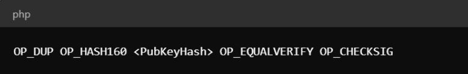

比特币作为加密货币的先驱，长期以来以简洁、无可匹敌的安全性和去中心化特性著称。但比特币脚本的某些方面，包括特定操作码，在社区中引发了讨论与好奇。OP_CAT 就是其中之一，其名称是 Operation Concatenate 的缩写。本文将揭开 OP_CAT 的面纱，探讨其历史、重新启用的可能性，以及它可能给比特币智能合约和整体功能带来的变革。

## Bitcoin Script 与操作码：区块链交易的基础

比特币的脚本语言是网络的一项基础组成部分，却常被忽视。[比特币脚本（Bitcoin Script）](https://www.nervos.org/knowledge-base/bitcoin_script) 是一种基于栈的语言，能够在比特币交易中执行复杂指令。与通用应用编程语言不同，比特币脚本并不具有[图灵完备性（Turing completeness）](https://en.wikipedia.org/wiki/Turing_completeness)，它刻意限制功能，以增强安全性和可预测性。这种约束对于防范某些恶意活动、确保脚本确定性执行至关重要。

### 什么是比特币操作码？

对于初学者，[操作码（opcodes）](https://www.nervos.org/knowledge-base/what_are_opcodes)即 operation codes，是比特币脚本语言的基本构件。每个操作码代表脚本可以执行的一条具体命令或一种功能，从简单算术运算到复杂密码学函数不等。

更具体地说，操作码是单字节指令，指定脚本执行时对栈（stack）进行的某项操作。栈是一种数据结构，用于在脚本中存储和操作数据。处理比特币交易时，脚本会执行，操作码则规定验证交易所需的操作顺序。例如，`OP_DUP` 复制栈顶项，`OP_HASH160` 对栈顶项应用哈希函数。比特币脚本中有不同类型的操作码：

- **栈操作：** 包括复制（`OP_DUP`）、移除（`OP_DROP`）和交换（`OP_SWAP`）栈项等基本操作。
- **算术运算：** `OP_ADD`、`OP_SUB` 等操作码对栈项执行基本算术运算。
- **密码学操作：** 包括执行密码学函数的操作码，例如验证数字签名的 `OP_CHECKSIG`，以及 `OP_SHA256`，它会应用 [SHA-256](https://www.nervos.org/knowledge-base/SHA256_most_used_hash_function) 哈希函数。
- **控制流操作：** `OP_IF`、`OP_ELSE` 等操作码控制脚本执行流程，允许按条件执行代码块。

操作码支持在比特币网络上创建多种交易类型和智能合约。例如，多重签名交易利用 `OP_CHECKMULTISIG`，要求多个签名才能通过验证。特定操作码组合还支持条件支付和原子交换，使更复杂的金融交易和不同区块链之间的互操作成为可能。

### 操作码的实际示例

为了更好地说明操作码如何工作，可以看看标准比特币交易脚本中的 `OP_CHECKSIG`。脚本可能如下：

在这个脚本中：

* `OP_DUP` 复制栈顶项。
* `OP_HASH160` 对复制出的公钥进行哈希运算。
* `OP_EQUALVERIFY` 检查公钥的哈希值是否与给定公钥哈希匹配。
* `OP_CHECKSIG` 使用公钥验证签名。

这一操作序列确保只有提供正确签名时交易才有效，展示了操作码如何协同执行安全与有效性条件。

## 什么是比特币中的 OP_CAT？

比特币早期，[中本聪（Satoshi Nakamoto）](https://en.wikipedia.org/wiki/Satoshi_Nakamoto)加入了多种支持广泛功能的操作码，其中就有 OP_CAT，用来拼接（连接）栈上的两个数据值。但在 2010 年，OP_CAT 与其他几个操作码因安全担忧被禁用。主要问题是，OP_CAT 可能被用来创建消耗过多资源的脚本，进而对网络造成[拒绝服务（DoS）攻击](https://en.wikipedia.org/wiki/Denial-of-service_attack)。

### OP_CAT 最初的用例与局限

OP_CAT 最初被设想用于增强比特币脚本能力，支持更复杂的交易条件。但潜在滥用风险导致它被停用。数据拼接能力可能以难以完全预测的方式被利用，引发对网络稳定性和安全的担忧。最初的限制主要围绕 DoS 攻击风险：拼接后过大的数据值可能扰乱网络正常运行。

## 推动重新启用 OP_CAT

自早期以来，比特币网络已有显著发展，尤其是在 2021 年引入 [Taproot 升级](https://www.investopedia.com/bitcoin-taproot-upgrade-5210039)之后。Taproot 增强了比特币脚本语言，使其更高效、更注重隐私。一项关键进展，是缓解了最初导致 OP_CAT 被禁用的漏洞。这让人们重新关注启用 OP_CAT，因为改进后的脚本环境现在能够更安全地处理其功能。

比特币社区中的若干重要人物和团体正在倡导重新启用 OP_CAT，其中包括 Taproot Wizards 和 Botanix Labs。他们认为，OP_CAT 能显著增强比特币的智能合约能力，带来更完善的安全机制、更灵活的交易条件，以及创建更复杂智能合约的能力。其理由是，在安全措施增强后，OP_CAT 的收益可能超过风险。

## OP_CAT 的潜在用例：智能合约、契约及其他

OP_CAT 最有吸引力的用例之一，是智能合约和契约（covenants）。智能合约是将协议条款直接写入代码、自动执行的合约；[契约](https://www.nervos.org/knowledge-base/what_are_bitcoin_covenants)则对 UTXO 的花费方式施加条件。OP_CAT 允许脚本内的数据拼接，有助于创建更动态、更灵活的智能合约，实现此前无法实现的复杂交易条件，增强比特币的整体功能。

例如，合约可以规定，只有多个数据点（如多个签名、基于时间的条件）被组合并验证后，才能释放资金。开发者据此可以在智能合约中实现更细致的条件，例如按里程碑完成情况分阶段释放付款的多阶段支付系统。此外，OP_CAT 还可能支持防止相互冲突声明的合约（non-equivocation contracts），用于防止闪电网络等支付通道中的双重支付（double-spending）尝试。通过拼接交易数据的不同部分，OP_CAT 可以执行相关条件，在检测到双重支付时惩罚交易或使其失效。

借助契约，OP_CAT 可以支持创建链上允许名单（allow lists），指定哪些地址可以接收资金。这适用于继承方案，在特定条件下将比特币传给指定受益人。允许名单可以是动态的，根据脚本编码的预设规则变化。这让资金管理更灵活、更安全，尤其适用于涉及多个受益人或多项条件的复杂场景。

OP_CAT 也能在改善比特币网络安全机制方面发挥关键作用。例如，可以用它创建“金库（vaults）”，这是一类施加严格花费条件的特殊智能合约。金库可以要求经过多个步骤和批准才能释放资金，增加一层安全保障。此外，OP_CAT 可以支持创建防冲突声明合约，更有效地防止闪电网络等支付通道中的参与者作恶。

也许最重要的是，OP_CAT 可以增强比特币与其他区块链及 Layer 2 方案的互操作性。通过支持更复杂的数据拼接，OP_CAT 能够促进跨链桥的构建，在不同区块链网络之间安全转移资产。这种互操作能力，对去中心化交易所以及其他依赖多链生态顺畅交互的应用至关重要。

## 技术考量与挑战

### 脚本大小与网络效率

重新启用 OP_CAT 的主要担忧之一，是它可能影响脚本大小与网络效率。数据值拼接可能导致脚本变大，进而占用更多区块空间，影响网络整体效率和交易吞吐量。必须充分分析并处理这些潜在问题，确保 OP_CAT 的好处不以网络性能为代价。

### 安全风险与缓解措施

重新启用 OP_CAT 也带来一定安全风险。与任何比特币协议变更一样，广泛测试和分析至关重要，才能确保操作码不会引入新漏洞。比特币社区在协议变更上向来谨慎，优先考虑安全与稳定。任何重新启用 OP_CAT 的提案，都需要接受严格审查，充分回应这些担忧。

### 共识与实现挑战

在比特币社区内达成共识并不容易。比特币的去中心化特性，意味着任何重大协议变更都需要开发者、矿工和用户之间的广泛认同。协议变更有多种实施方式，例如[软分叉和硬分叉](https://www.nervos.org/knowledge-base/what_is_a_hard_fork_soft_fork)。这类升级通常优先采用向后兼容的软分叉，但达成共识和协调实施仍可能困难且耗时。

## 未来前景与社区态度

### 激活时间表

OP_CAT 可能何时重新启用尚不确定，取决于多个因素。比特币社区中的知名人士表示，如果提案获得支持，可能在六个月至一年内实现。但达成共识、充分测试操作码实现的过程，也可能延长这一时间。社区的审慎态度确保任何变更都优先考虑网络安全与稳定。

### 持续讨论与社区观点

围绕 OP_CAT 的讨论活跃且持续。有些成员对潜在好处充满热情，另一些则对风险保持谨慎。这种多元观点是比特币社区的特点，体现了其去中心化和民主特性。最终决定很可能取决于对收益和风险的充分权衡，并高度重视网络安全与稳定。

## 结语

OP_CAT 是比特币持续演进中引人关注的一章。从早期前景可期但存在缺陷的操作码，到可能被重新启用，OP_CAT 展现了比特币网络的活力和创新性。随着社区持续讨论和探索，OP_CAT 可能解锁新功能，增强比特币作为领先加密货币的地位。OP_CAT 的历程体现了比特币的韧性，以及社区对持续改进的坚持。
