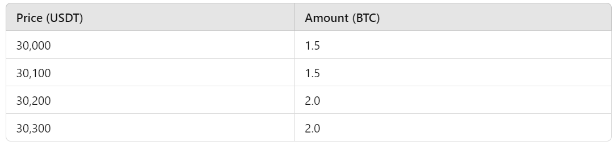

滑点的变化会对交易者产生显著影响，在波动剧烈的加密货币市场尤其如此。对任何参与加密货币交易的人来说，理解滑点、其成因，以及它在中心化和去中心化交易所中的差异，都至关重要。

## 理解加密货币交易中的滑点

滑点（slippage）是买单和卖单都可能出现的价格偏差，在加密货币等高波动市场中尤为常见。滑点分为正滑点和负滑点。实际成交价格优于预期时，出现正滑点；实际成交价格劣于预期时，则出现负滑点。

### 滑点的成因

加密货币交易中出现滑点有多种原因，其中一个主要原因是市场波动。加密货币价格可能在短时间内大幅变化，突然的价格变动会让交易以不同于预期的价格成交。

另一个因素是订单规模。大额订单可能显著影响市场价格，尤其是订单规模超过目标价位可用流动性时。流动性不足会使交易无法全部按预定价格成交，从而产生滑点。

流动性是影响滑点的关键因素。在流动性较低的市场中，预期价格上可能没有足够的买方或卖方，导致交易以较不利的价格成交。由于缺乏足够的市场参与者在预定价位承接大额订单，滑点在流动性不足的市场中更为常见。

延迟，即下单与成交之间的时间差，也会显著影响滑点。在变化迅速的市场中，即使短暂延迟也可能伴随显著价格变化，使交易以不同于最初预期的价格成交。在价格经常快速变化的加密货币市场中，情况尤其如此。

### 去中心化交易所中的滑点实例

为了更好地理解滑点，来看下面这个例子：

假设你想在 Uniswap 上用 10 ETH 兑换 USDC。Uniswap 是以太坊上一个常用的去中心化交易所（DEX），采用自动做市商（Automated Market Maker，AMM）模型。

#### **初始条件：**

* 当前兑换比例为 1 ETH = 2000 USDC。
* ETH/USDC 交易对的流动性池（liquidity pool）中共有 1000 ETH 和 2,000,000 USDC。
* AMM 使用恒定乘积公式（**x * y = k**），其中 **x** 和 **y** 分别为池中的 ETH 和 USDC 数量，**k** 是常数。

#### **预期成交结果：**

根据当前兑换比例，你预期收到：

10 ETH × 2000 USDC/ETH = 20,000 USDC

**实际成交结果：**

执行交易时，AMM 模型会根据交易后池中 ETH 和 USDC 的新比例调整价格。我们来计算具体影响。

1. **交易前的池状态：**
    * ETH: 1000
    * USDC: 2,000,000
    * 恒定乘积（k）：1000 ETH * 2,000,000 USDC = 2,000,000,000
2. **交易后的池状态：**
    * 向池中加入 10 ETH 后，新的 ETH 数量为 1010。
    * 为保持乘积不变，新的 USDC 数量必须满足等式：1010 ETH×新的 USDC 数量=2,000,000,000。
    * 新的 USDC 数量=2,000,000,000/1010​≈1,980,198 USDC
3. **收到的 USDC 数量：**
    * 你收到的 USDC 数量，是初始 USDC 数量与新数量之差：

        USDC Received = 2,000,000 − 1,980,198 = 19,802 USDC

4. **滑点计算：**
    * 预期 USDC：20,000 USDC
    * 实际 USDC：19,802 USDC
    * 滑点：20,000 − 19,802 = 198 USDC

在这个例子中，根据当前兑换比例，你原本打算用 10 ETH 换取 20,000 USDC。但由于 Uniswap 的 AMM 模型中的流动性变化，你实际收到的是 19,802 USDC，产生了 198 USDC 的负滑点。这个例子说明，在去中心化交易所中，相对于流动性池规模较大的交易，可能产生显著滑点。

## 中心化交易所中的滑点示例

下面以 Binance 这样的中心化交易所（CEX）为例，看看滑点如何发生。

#### **场景：**

你想在 Binance 上使用 USDT（Tether）购买 5 BTC（比特币）。

#### **初始条件：**

* BTC 当前的市场价格为每 BTC 30,000 USDT。
* 订单簿中有以下卖单（为便于举例，已作简化）：

#### **预期成交结果：**

根据当前市场价格，你预期花费：

5 BTC×30,000 USDT/BTC=150,000 USDT

#### **实际成交结果：**

当你提交市价单购买 5 BTC 时，订单会根据订单簿中的可用卖单，从最低价到最高价依次成交，直到全部完成。

1. **订单簿撮合：**
    * 前 1.5 BTC 按 30,000 USDT/BTC 买入。
    * 接下来的 1.5 BTC 按 30,100 USDT/BTC 买入。
    * 剩余 2.0 BTC 按 30,200 USDT/BTC 买入。
2. **总成本计算：**
    * 前 1.5 BTC 的成本：1.5 BTC×30,000 USDT/BTC=45,000 USDT
    * 接下来 1.5 BTC 的成本：1.5 BTC×30,100 USDT/BTC=45,150 USDT
    * 剩余 2 BTC 的成本：2 BTC×30,200 USDT/BTC=60,400 USDT
3. **总支出：** 45,000 USDT+45,150 USDT+60,400 USDT=150,550 USDT
4. **滑点计算：**
    * 预期成本：150,000 USDT
    * 实际成本：150,550 USDT
    * 滑点：150,550−150,000=550 USDT

在这个例子中，你原本打算按每 BTC 30,000 USDT 的当前市价购买 5 BTC，预期花费 150,000 USDT。但由于该价位的流动性有限，你的订单需要与价格更高的卖单撮合，实际花费了 150,550 USDT，产生了 550 USDT 的负滑点。这个例子说明，当订单簿在目标价位没有足够深度时，大额市价单可能在中心化交易所产生滑点。

## 结语
加密货币交易中出现滑点有多种原因，最常见的是市场波动、延迟和相对流动性，这些因素在波动剧烈的加密货币市场中尤其突出。在新兴的加密货币交易领域，有许多专业知识值得学习；与此同时，巨额获利的故事屡见不鲜，令人遗憾的惨重亏损也同样不少。
