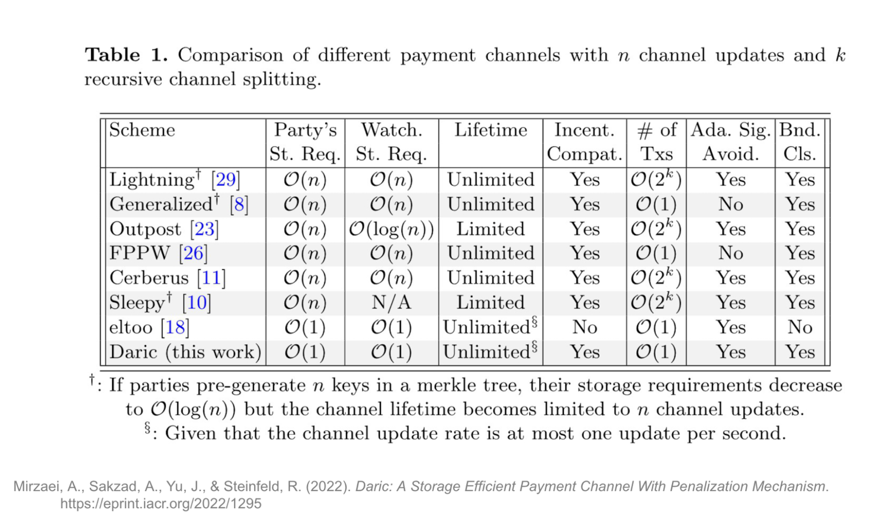

比特币改变了资金流转的方式。人们首次能够在全球范围内转移价值，而无需依赖银行、支付处理商或其他中心化中介。

但比特币的首要设计目标是安全和去中心化，而非处理海量日常小额支付。每笔交易都会广播到网络，由数千个节点独立验证，并永久记录在这些节点各自复制的共享账本中。这使系统无需依赖可信第三方（trustless），并且能够独立验证，但也限制了它能处理的支付数量，尤其是小额、高频或持续发生的支付。

闪电网络引入了另一种模型。用户将资金锁定到称为支付通道（payment channels）的私密链下账本中，私下即时更新余额，而不将每笔支付都记录在链上。只有开设通道、结算最终余额或解决争议时，才需要用到区块链。

真正的突破出现在通道相互连接之后。用户不必再为每个想要付款的个人或商家开设直连通道，支付可以沿着一串既有通道进行路由（routing），把一组组私有资金关系连接成全球支付网络。

闪电网络证明，支付通道能够将缓慢的结算层转变为快速的全球支付基础设施。但它也表明，底层区块链深刻影响着这种网络的形态。比特币脚本系统的限制、单一原生资产，以及其文化中对协议变更的抵触，都限制了闪电网络进一步演进的空间。

Fiber 采用相同的支付通道模型，但构建于 CKB 之上。CKB 是一条可编程性更强、密码学机制更灵活的区块链。不同的基础，让 Fiber 能够保留闪电网络行之有效的部分，同时将这一模型延伸到闪电网络设计时未打算支持的领域。

因此，要理解 Fiber，需要先了解支付通道解决的问题、闪电网络带来的突破、比特币对闪电网络施加的限制，以及下一代支付通道网络值得期待的能力。

## 1\. 区块链三难困境与 Layer 2 的必要性

### 1.1 区块链为什么会遇到瓶颈

比特币吞吐量有限并非偶然，而是源于去中心化区块链的运作方式。

比特币不依赖中心化运营者维护账本，而是让数千个独立节点各自保存副本，并自行验证每笔交易。这种冗余使网络难以被审查或操纵。没有任何一方可以独自决定哪些交易有效，也没有人能悄悄重写账本。

但这一优势也形成了瓶颈。每笔交易都必须在全网分发，由每个全节点（full node）验证，并由数千个节点永久存储。比特币处理的交易越多，每个节点需要的带宽、算力和存储空间也就越多。

这种矛盾通常被称为[区块链不可能三角](https://www.nervos.org/knowledge-base/blockchain_trilemma)。每条区块链都希望兼顾安全、去中心化和可扩展性，但改善其中一个属性，往往会给其他属性带来压力。例如，增大区块或缩短出块间隔，可以让比特币处理更多交易，却也会提高运行全节点的硬件要求，使网络逐渐向资源更充足的参与者集中。

比特币在这一权衡中作出了有意的选择：保持区块相对较小，约每十分钟产生一个区块，以吞吐量为代价保障安全与去中心化。由此得到的是极为稳健的基础层，却只能每秒处理约七笔交易，远不足以支撑全球规模的支付。

这并不意味着行业已停止探索更好的区块链扩容方式。零知识（ZK）系统就是最有前景的方向之一。它让大量计算在链下完成，再将结果压缩成一个小型密码学证明；节点验证证明的效率，远高于自己重复全部计算。

这减轻了基础层的负担，同时保留其最终验证者的角色。但[零知识系统](https://www.nervos.org/knowledge-base/zero_knowledge_proofs)也有取舍：生成证明需要大量计算，系统本身也很复杂；[ZK Rollup](https://www.nervos.org/knowledge-base/zk_rollup_vs_optimistic_rollup)通常设计为支持多类应用的共享执行环境，而非专为数百万笔微小、即时、低成本支付优化的系统。

对于高频、低成本转账这一特定任务，另一条路线已被证明更加自然：将大部分支付活动移出主链。围绕这一思路，出现了侧链、Rollup 和支付通道网络等多种扩容设计。

### 1.2 选择 Layer 2 方案：为什么采用支付通道网络？

将活动移出基础层，并不能用同一种方式解决所有问题。不同扩容系统作出的取舍不同，也适合不同类型的活动。

[侧链（sidechains）](https://www.nervos.org/knowledge-base/sidechains_unlocking_the_potential)将交易移到一条与比特币相连、但拥有自身规则、验证者和安全模型的独立区块链上。这给开发者带来更多灵活性，但用户也不再直接依赖比特币的安全。其资产的安全程度，取决于侧链以及连接侧链与比特币的桥。因此，与其将侧链视为真正的 Layer 2 系统，不如将其理解为并行网络。

Rollup 采用另一种方式：在链下执行大量交易，将结果打包，再向基础层发布数据或密码学证明。这使其适合需要共享状态和复杂智能合约的通用应用。但它们仍然是公共执行环境，许多用户在其中争用同一份区块空间和处理能力。

[支付通道网络（Payment channel networks）](https://www.nervos.org/knowledge-base/ultimate_guide_to_payment_channels)则更加专门化，专为高频、低成本、实时转账设计。两名参与者将资金锁定在链上合约中，私下更新彼此间的余额，而不将每笔支付记入共享账本。只有开设、关闭通道或发生争议时，才使用区块链。

Fiber 虽然为更先进的多方设计打开了空间，但传统支付通道连接的是两方。支付通道网络将许多这样的通道连接起来，让没有直连通道的人也能通过路由完成支付。

这正是该模型具备可扩展性的原因：用户无需与每个收款方分别建立通道并注资，只需在网络中找到一条可行路径。

接下来要理解的是，这样的网络实际如何运作。

## 2\. 闪电网络的解决方案

闪电网络是最广为人知的支付通道网络。

要理解它的运作方式，需要考察两个相互关联的机制：单条通道的生命周期，以及将多条通道连接成网络的路由逻辑。

### 2.1 支付通道与多跳路由

**支付通道的生命周期**

一条支付通道会经历三个阶段：

1. **开设通道：** 两名参与者就通道条款达成一致，将资金锁定在一个共享链上合约中。这笔注资交易（funding transaction）确定了通道内可用的流动性。  
2. **更新余额：** 通道开设后，参与者可以通过签署新版通道余额相互付款。每次更新都会替代此前商定的状态（state），而资金本身仍锁定在原合约中。更新在链下进行，因此几乎即时完成，也无需向基础层支付交易手续费。  
3. **关闭通道：** 参与者准备结算时，将最新通道状态发布到链上，合约随后按最终余额分配锁定的资金。如果双方配合，通道可以立即关闭；如果意见不一致，或一方失联，协议也提供了单方面结算通道的方式。

单条通道让两方之间的反复支付更高效，而更大的突破来自多条通道相连。

**通过网络付款**

假设 Alice 想给 Bob 付款，但两人没有直连通道。不过，Alice 与 Claire 有通道，Claire 与 Dominic 有通道，Dominic 又与 Bob 有通道。

闪电网络可以沿着这条通道链路路由支付：

**Alice → Claire → Dominic → Bob**

每个中间节点通过自己的某条通道转发支付，并收取少量路由手续费。Alice 无需认识或信任 Claire 和 Dominic，也无需与 Bob 新开一条通道。

不过，只有路径上的每条通道在正确方向上都有足够流动性，支付才能通过。

假设 Alice 想给 Bob 发送 15,000 聪（0.00015000 BTC），Claire 必须有至少这么多可向 Dominic 转出的资金，Dominic 也必须有足够的资金可转给 Bob。即使一条通道的资金总量很充足，如果资金都在错误的一侧，仍然无法承载这笔支付。

因此，流动性是支付通道网络的核心约束。只有当路径上沿支付方向已有足够可用价值时，支付才能通过。

条件满足时，效果很显著：支付能在数秒内穿过多条独立通道，而其中任何一笔转移都无需记录到链上。因此，网络的处理能力更取决于通道流动性（channel liquidity）和节点通信速度，而非比特币的交易吞吐量。

但通过陌生人路由支付，带来了一个明显问题：网络如何保证每个中间节点都会转发资金，而不是将其据为己有？

### 2.2 闪电网络如何让路由支付无需依赖可信第三方

通过多个陌生人转发支付，前提是任何中间节点都无法偷走资金，也不能让支付停在半完成状态。

闪电网络通过**哈希时间锁合约（Hashed Time-Locked Contract）**，即 **HTLC**，解决这一问题。HTLC 结合了两个条件：

* **哈希锁（hashlock）**：只有提供正确的秘密值，资金才会释放；  
* **时间锁（timelock）**：如果截止时间前没有提供秘密值，资金就会退回。

支付从接收方 Bob 开始。他生成一个随机秘密值，称为**原像（preimage）**，再将其密码学哈希作为闪电发票（Lightning invoice）的一部分发送给 Alice。Alice 无法从哈希推导出秘密值，但可以用这个哈希锁定支付。

Alice 随后创建一个 HTLC，其含义是：

> Bob 可以通过提供与这个哈希匹配的秘密值领取资金。否则，截止时间过后，Alice 可以取回资金。

支付经过 Claire 和 Dominic 时，每一跳都会用同一个哈希创建对应的 HTLC。Alice 为 Claire 锁定资金，Claire 为 Dominic 锁定资金，Dominic 为 Bob 锁定资金。

支付由此形成一串有条件的承诺：

**Alice → Claire → Dominic → Bob**

Bob 通过公开原像领取最终付款。Dominic 得知秘密值后，用它从 Claire 领取自己应收的款项；Claire 再用同一个秘密值，从 Alice 领取自己的款项。

原像沿路径反向传递，支付则向前流动。

这使整个转账具备**原子性（atomic）**：要么每一跳都完成，要么全部不完成。如果 Bob 始终没有公开秘密值，时间锁最终会到期，每位参与者都能取回自己的资金。

实际效果是，Alice 可以安全地通过素未谋面的人向 Bob 付款，而无需相信任何中间节点不会偷走资金。

### 2.3 防范欺诈：惩罚与瞭望塔

通道余额在链下私下更新，因此存在明显的作弊诱因。不诚实的参与者可能广播一笔过期的承诺交易（commitment transaction），按对自己更有利的旧余额领取资金。闪电网络用惩罚机制防止这种行为。

每当通道状态变化，双方都会交换撤销秘密值（revocation secret），使上一状态失效。如果有人之后广播已撤销的交易企图作弊，其资金会被时间锁暂时锁住。持有对应撤销秘密值的诚实一方，可以绕过等待期，执行惩罚交易，领取整个通道的余额。

这种机制效果强大：它通过让欺诈必然无利可图来促使参与者诚实，而不依赖信任或善意。

不过，它有一个实际限制。发现作弊需要监控区块链上的已撤销交易，并在时间锁到期前作出响应。普通用户不可能让电脑全天候在线，因此闪电协议允许他们将这一任务委托给所谓的瞭望塔（Watchtowers）。

瞭望塔是自动化的第三方节点，监测区块链上是否出现违反通道约定的状态。一旦发现已撤销的交易，它就代表离线用户广播惩罚交易。

这样，用户可以委托他人监测欺诈，不必让钱包全天候在线。实践中，瞭望塔让闪电网络更易于使用：人们可以按需上线、离线，不必担心离线会让资金面临被盗风险。

### 2.4 寻找路径：Gossip、寻路与洋葱路由

Alice 向 Bob 付款之前，钱包必须回答一个基本问题：哪一串通道能够真正将支付从她那里送到 Bob 手中？

这需要三方面配合：网络地图、选择可行路径的方式，以及保护路径隐私的方式。

#### **构建网络地图**

闪电网络没有显示各方连接关系的中央目录。节点会持续分享新通道、通道容量（channel capacities）和手续费信息。这些更新像人群中的传言一样在网络中传播，称为 **Gossip 协议（Gossip Protocol）**，让每个节点都能构建自己最新的网络地图。

#### **选择路径**

Alice 的钱包获得地图后，就会搜索通往 Bob 的路径。但路径不仅要将两人连起来，还要求沿途每条通道在正确方向上有足够流动性，同时总路由手续费和时间锁延迟也必须在可接受范围内。

因此，最佳路径并不总是最短路径，而是在流动性、成本、可靠性和时间之间取得最佳平衡的路径。

#### **保护路径隐私**

路径选定后，闪电网络使用[洋葱路由（Onion Routing）](https://www.onion-router.net/)隐藏完整支付路径。指令像洋葱一样被逐层加密包裹，每个中间节点只能解密转发支付所需的信息：下一跳、转出金额、获得的手续费以及到期时间。

任何中间节点都看不到完整路径，只知道支付从哪里来、下一步要发往哪里。

最后，闪电网络通过[蹦床路由（Trampoline Routing）](https://bitcoinops.org/en/topics/trampoline-payments/)支持移动钱包等轻量设备。移动钱包，也就是轻节点，可以将繁重的寻路（route-finding）工作交给能力更强的节点，而不必自行完成。这样的节点称为蹦床节点，是一个路由枢纽，维护完整、最新的网络和通道流动性地图；普通移动客户端无法负担这些工作。蹦床路由免去了移动客户端繁重的数据处理和计算，使手机使用闪电网络变得切实可行。

## 3\. 挑战与限制

闪电网络证明了支付通道网络能够让比特币足够快速、便宜，适用于日常支付，但系统仍有局限。

有些限制来自闪电网络自身的设计，包括支付如何路由、流动性如何管理，以及如何保障旧通道状态的安全；另一些则来自比特币，其受限的脚本系统约束了闪电网络能支持什么，以及演进的难易程度。

从路由层到基础链，这些限制揭示了下一代支付通道网络需要改进的方面。

### 3.1 HTLC 的漏洞与局限

HTLC 让无需依赖可信第三方的多跳支付成为可能，但对共享哈希锁和长时间锁的依赖，也带来了隐私与安全问题。

* **隐私泄露。** 路由支付的每一跳都使用同一个哈希。如果两个中间节点在路径不同位置观察到同一个哈希锁，就可能推断两笔转移属于同一笔支付，从而更容易跨网络追踪活动。  
* **容易受到攻击。** 基于 HTLC 的网络面临延迟支付、阻塞通道，以及迫使诚实用户浪费时间和流动性的攻击。漏洞源于网络中相同哈希锁与错开的时间锁相结合。时间锁形成一系列逐步缩短的到期时间，每一段都必须足够长，以应对最坏情况下的区块链确认延迟，并让诚实参与者在争议进入基础层时有时间响应。恶意参与者可以利用这一安全窗口，让支付一直悬而未决，直到接近到期，从而占用通道流动性，长时间削弱网络处理正常支付的能力。由于共享同一个哈希锁，发送者无法在不冒重复付款风险的情况下，安全地沿另一条路径重试这些停滞支付。

比 HTLC 更好的替代方案是点时间锁合约（Point Time-Locked Contracts，PTLC），后文会进一步介绍。

### 3.2 瞭望塔的存储问题

瞭望塔解决了一个问题，却带来了另一个随通道使用而日益严重的问题。

每当通道余额变化，双方都会撤销上一状态，并向瞭望塔提供针对这次更新的加密惩罚交易。瞭望塔无法预知最终会有人广播哪一个已撤销状态，因此必须保存所有这些交易。

于是，存储负担会随着通道更新次数持续增加。工程师称之为 **O(n) 存储复杂度**：更新次数翻倍，瞭望塔需要保留的数据量也大致翻倍。

对于繁忙通道，以及保护大量用户的瞭望塔，这可能随着时间推移演变成可观的存储和基础设施成本。

一项称为 [Eltoo](https://bitcoinops.org/en/topics/eltoo/) 的重新设计提案，可以让新通道状态覆盖旧状态，从而解决这一问题。这样，瞭望塔只需保存最新状态，无需保存整个通道历史。但 Eltoo 升级依赖比特币目前尚不支持的脚本功能，引入它需要通过软分叉进行全网协议升级，协调过程可能耗时数年。

后文将看到，Fiber 使用 [Daric 协议](https://eprint.iacr.org/2022/1295.pdf)实现了同样的基本效果：将瞭望塔不断增长的存储需求降为恒定需求。

### 3.3 基础层缺乏灵活性，以及变通方案的局限

Eltoo 体现了一项更广泛的限制：闪电网络的许多约束来自底层区块链。

比特币有意限制脚本语言的能力。这让基础层更易于保障安全和进行分析，但也意味着，闪电网络使用新功能前，可能需要经历数年的研究、争论和全网协调。

比特币原生也只识别一种资产：BTC。这很适合 BTC 支付，但稳定币和其他数字资产对日常商业活动越来越重要。

诚然，Taproot Assets 让其他资产能够通过比特币和闪电网络转移，提供了一种变通方案。但比特币并不原生识别这些资产，因此支持它们需要额外软件和专用基础设施，包括负责资产兑换、流动性管理以及汇率风险核算的边缘节点。

这种变通方案可以运作，但增加了额外复杂度；如果底层区块链原生支持多资产，这些复杂度本不会存在。

除比特币特有的限制外，闪电网络也面临所有支付通道网络共有的挑战：资金必须持续锁定在通道中，所需方向的流动性不足时支付可能失败，通道也需要定期再平衡。

这些约束共同表明，底层区块链对支付网络的影响有多深，也说明了为什么在不同基础上重建类似模型，可以打开新的可能。

## 4\. 认识 Fiber：构建于不同基础之上

前面的内容都围绕闪电网络展开：它带来的突破、运作方式，以及设计开始显露局限的地方。

这些背景很重要，因为 Fiber 并没有放弃支付通道模型。它从相同的基本架构出发：链上锁定资金、链下更新余额、通过相连通道路由支付，但在不同的基础层上重新构建。

Fiber 的优势恰恰从这里开始。构建于 CKB 之上，使 Fiber 能保留已被闪电网络验证的模型，同时克服比特币在通道可承载的资产、协议演进方式，以及周边配套基础设施方面施加的部分约束。

Fiber 的部分能力直接来自 [CKB](https://www.nervos.org/knowledge-base/nervos_overview_of_a_layered_blockchain)，包括原生多资产支持，以及更自由地引入新密码学功能；另一些来自 Fiber 自身的设计，例如更高效的瞭望塔机制，以及连接其他支付网络的基础设施。

### 4.1 基础层为什么重要

支付通道网络会继承底层区块链的优势和限制。

比特币为闪电网络提供高度安全、去中心化的结算层，也将它限制在比特币的脚本系统和单一原生资产之内。CKB 则为 Fiber 提供了另一组可能性。

第一个优势是**原生多资产支持**。CKB 可以直接在协议层面识别和跟踪不同资产类型。因此，Fiber 通道可以持有并路由 CKB、[稳定币](https://www.nervos.org/knowledge-base/becoming_money_stablecoins_on_lightning_the_next_step_in_bitcoins_journey)、RGB++ 资产及其他代币，无需先转换成一种共同的中间资产。这让 Fiber 能在统一网络中支持更广泛的用户和经济活动。

凭借这一基础，Fiber 绕过了闪电网络扩展到 BTC 以外资产时所需的边缘节点兑换模型。在闪电网络中，资产交换通常需要在链上和链下环境之间进行复杂的[潜水艇交换（Submarine Swaps）](https://docs.lightning.engineering/the-lightning-network/multihop-payments/understanding-submarine-swaps)，或依赖专门的边缘节点，例如 [Boltz](https://boltz.exchange/)、[Loop](https://lightning.engineering/loop/) 等交换服务提供者来处理兑换。Fiber 支付则无需转换为基础资产，就能在网络中流转，消除了这些兑换通常引入的额外定价复杂度和汇率波动。

此外，这一架构通过原生、无需依赖可信第三方的交换功能，让支付网络本身能够充当低延迟的去中心化交易所。实际运作中，通道会同时持有多种代币，用户可以直接在路由过程中进行无需依赖可信第三方的原子交换。例如，用户可以从自己的通道发出 CKB，接收者则顺畅地收到稳定币。中间路由节点沿通道促成兑换，保持交易安全和原子性，并为提供的流动性收取费用。

第二个优势可能影响更深远：表达能力。在 CKB 上，支付通道规则不是区块链内置的一小组受限操作，而是程序。

CKB 将状态存储在 [Cell](https://docs.nervos.org/docs/ckb-fundamentals/cell-model) 中，附着于 Cell 的脚本决定谁能访问资产，以及交易必须满足什么条件。这些脚本在 [CKB-VM](https://www.nervos.org/knowledge-base/comparing_blockchain_virtual_machines) 内运行；它是基于 RISC-V 的通用虚拟机，不绑定特定密码学算法。因此，Fiber 的通道注资和承诺规则以可编程的 CKB 脚本实现，而不是嵌入基础协议的固定行为。

这让 Fiber 开发者能够更充分地控制通道生命周期。他们可以为通道状态的更新、撤销、结算或争议处理设计更丰富的规则，引入新的授权和密码学机制，并将 Fiber 的结算逻辑与 CKB 上的其他资产和应用组合起来。

当新通道设计需要基础链尚不支持的功能时，这一区别最为明显。在比特币上，闪电网络必须在 Bitcoin Script 的范围内工作。如果缺少所需的操作码（opcode）或签名行为，就像 Eltoo 所面临的情况一样，这项功能只能等待比特币自身发生变化。

在 CKB 上，这类创新可以在应用层进行。开发者可以将新的验证和状态转换逻辑写成 CKB 脚本，无需改变区块链共识规则。[契约（covenants）](https://www.nervos.org/knowledge-base/what_are_bitcoin_covenants)就是 CKB 架构可以直接表达的一种功能，它让资产能够携带约束未来花费方式的规则。

因此，Fiber 不只是移植到另一条区块链上的闪电网络。CKB 为支付通道模型提供了演进空间：从主要为单一资产转账优化的固定通道，发展为更灵活的资金关系，支持新资产、新密码学、新争议机制、原子交换，以及最终更可编程的支付形式。

这些属性让 Fiber 能够保留闪电网络的速度，同时迈向表达能力更强的多资产支付与交换网络。接下来会看到，CKB 的灵活性已经让 Fiber 能够重新设计闪电网络一个长期存在的基础设施问题：瞭望塔不断增长的存储负担。

### 4.2 改进瞭望塔，连接支付网络

CKB 的可编程性不仅为 Fiber 未来演进留出空间，也让网络能够改善支付通道模型中已经存在的实际问题。

#### **解决瞭望塔存储问题**

如前所述，闪电网络瞭望塔必须保留每个已撤销通道状态的数据。通道更新越频繁，瞭望塔需要存储的信息越多，长期形成不断增长的基础设施负担。

Fiber 利用 [Daric 协议](https://eprint.iacr.org/2022/1295.pdf)解决这一问题，而这得益于 CKB 对契约的支持。在 Daric 中，每个通道状态都有版本号，新状态会自动覆盖任何旧状态。

这改变了瞭望塔需要记住的内容。它不必为每次历史更新保存单独的惩罚交易，只需保留最新有效状态。如果有人尝试结算旧版本，瞭望塔就能用新版本响应。

结果是存储需求恒定。闪电网络式瞭望塔的存储复杂度为 **O(n)**，即每次通道更新都会增加数据负担。Daric 将其降为 **O(1)**：无论通道处理多少笔支付，数据量都保持不变。

对单个用户来说，这一区别可能并不显眼。但对于保护数千条繁忙通道的瞭望塔，它可以大幅降低存储成本，让基础设施更容易规模化运行。

#### **连接支付通道网络（PCN）**

Fiber 还设计为通过跨链枢纽（Cross-Chain Hubs），连接闪电网络等其他支付网络。

跨链枢纽是同时在两个网络上运行的路由节点。它在一侧接收支付，在另一侧创建对应支付，让价值在网络间转移，而无需发送者与接收者使用同一条区块链。

这一机制建立在闪电网络已经使用的 HTLC 结构上。假设 Alice 想从 Fiber 向闪电网络上的 Bob 转账，枢纽会在两个网络上用同一个哈希锁创建有条件支付。Bob 公开原像领取闪电网络付款后，枢纽就用同一个原像领取 Fiber 上对应的资金。

由于两侧依赖同一个秘密值，转移保持原子性：要么两笔支付都完成，要么都到期并退回资金。用户无需相信枢纽在收到一侧资金后会完成另一侧的支付。

要实现这一设计，两个网络都必须支持兼容的密码学原语，使同一个原像能解锁两侧支付。所交换资产之间也必须具有可预测的关系，通常是固定的 1:1 价值关系，枢纽才能路由等值金额，而无需为每次转移重新协商汇率。

在这里，跨链枢纽并不充当持有用户资金的托管桥，而是跨越两个支付网络的路由节点，通过连接它们赚取手续费。

Daric 降低了维护通道安全的成本，跨链枢纽则将网络的覆盖范围扩展到 CKB 之外。前者改善 Fiber 的内部运作，后者让它能够连接其他地方的支付基础设施。

### 4.3 未来升级至 PTLC 的路径

Fiber 目前使用 HTLC 保障路由支付。如前所述，HTLC 能正常运作，但整条路径共享同一个哈希锁，带来了隐私和安全限制。

更长期的升级方向是 PTLC。它不再用同一个哈希锁定每一跳，而是为每一跳提供各自的锁，这些锁在密码学上相互关联，并由椭圆曲线点推导而来。

这一小小变化，会带来几个重要结果。

首先，隐私得到改善。使用 HTLC 时，两个串通的节点可以比较哈希锁，识别它们是否属于同一笔支付。PTLC 消除了这一共享标识，使路径不同部分更难关联。

其次，PTLC 让支付重试更安全。HTLC 支付停滞时，由于每次尝试依赖同一个底层秘密值，重试可能带来重复付款风险。使用 PTLC 时，每次尝试都采用一组全新的锁，让发送者可以尝试另一条路径，而不再次暴露同一支付条件。

PTLC 也能防止虫洞攻击（wormhole attacks）。这种攻击中，两个串通的中间节点在路径不同位置识别出同一笔支付，绕过它们之间的节点，收取自己没有完成的转发工作的手续费。由于 PTLC 为每一跳分配不同的锁，攻击者无法再以相同方式关联支付并抄近路。

PTLC 并非 Fiber 独有，闪电网络开发者也在推进这一方向。区别在于，CKB 让 Fiber 能够更灵活地采用新密码学机制，无需等待基础层升级。

目前，PTLC 仍是更长期的方向，尚非核心生产功能。

## 5\. 面向规模化的 Fiber 工程设计

Fiber 的优势不只来自底层区块链。Fiber 节点实现从一开始就设计为同时管理多条通道、多笔支付和多项网络更新。

支付通道节点可能同时运行数百条活跃通道。rust-lightning 等传统闪电网络实现，通过共享状态锁协调这些操作。当一个进程更新通道时，涉及同一数据的其他操作必须等待锁释放。活动繁忙时，这种排队可能成为瓶颈。

Fiber 则使用 Actor 模型（Actor Model）。每条通道作为独立 Actor 运行，拥有自己的状态和消息队列。Actor 通过消息传递通信，而非共享内存，让不同通道能够并发处理活动，无需争用同一份数据。

Fiber 在这一架构中使用 RocksDB 快速存储状态，并用 Molecule 实现确定性的消息编码。Molecule 确保相同消息在不同计算环境中都转换为完全相同的字节序列，这对数据的哈希和签名至关重要。

Fiber 节点实现还简化了节点离线后的同步过程。闪电网络节点通常会请求一定范围的历史 Gossip 数据，以确定错过了哪些信息。Fiber 则记录标记节点最后已知位置的游标。节点重新连接时，从该位置继续，仅接收此后发生的更新。

最后，Fiber 将洋葱路由实现为独立模块，而不是与节点其余部分紧密耦合。这让代码库更易维护，也让单独组件可以升级，而不必迫使整个系统随之修改。

用户通常看不到这些设计选择，但随着网络增长，它们的好处越来越重要：能够并发处理更多支付，节点离线后能够更高效地恢复，软件也可以演进，而无需让每次改进波及整个实现。

## 闪电网络与 Fiber 概览

下表总结了全文讨论的主要架构差异。

<table border="1" cellpadding="8" cellspacing="0" style="border-collapse: collapse; width: 100%; font-size: 0.9em; border: 1px solid #ddd;">
  <thead>
    <tr>
      <th style="border: 1px solid #000; padding: 8px; text-align: left;">功能／架构</th>
      <th style="border: 1px solid #000; padding: 8px; text-align: left;">比特币上的闪电网络</th>
      <th style="border: 1px solid #000; padding: 8px; text-align: left;">CKB 上的 Fiber 网络</th>
    </tr>
  </thead>
  <tbody>
    <tr>
      <td style="border: 1px solid #000; padding: 8px;"><strong>基础层</strong></td>
      <td style="border: 1px solid #000; padding: 8px;">比特币：约 10 分钟的出块间隔，以及有意受限的脚本环境</td>
      <td style="border: 1px solid #000; padding: 8px;">CKB：约 10 秒的出块间隔，并通过 CKB-VM 提供通用执行环境</td>
    </tr>
    <tr>
      <td style="border: 1px solid #000; padding: 8px;"><strong>原生资产支持</strong></td>
      <td style="border: 1px solid #000; padding: 8px;">比特币原生只识别 BTC；其他资产需要 Taproot Assets、边缘节点等额外协议和基础设施</td>
      <td style="border: 1px solid #000; padding: 8px;">设计为原生承载 CKB、稳定币、UDT、RGB++ 资产及其他代币</td>
    </tr>
    <tr>
      <td style="border: 1px solid #000; padding: 8px;"><strong>通道表达能力</strong></td>
      <td style="border: 1px solid #000; padding: 8px;">通道逻辑受限于 Bitcoin Script 所提供的功能；重大新能力可能需要比特币协议升级</td>
      <td style="border: 1px solid #000; padding: 8px;">通道合约以可编程的 CKB 脚本实现，允许开发者在应用层引入更丰富的状态转换、授权、结算和争议处理逻辑</td>
    </tr>
    <tr>
      <td style="border: 1px solid #000; padding: 8px;"><strong>节点并发架构</strong></td>
      <td style="border: 1px solid #000; padding: 8px;">常见实现采用共享状态锁，操作访问同一通道数据时可能排队</td>
      <td style="border: 1px solid #000; padding: 8px;">采用 Actor 模型隔离通道状态，并发处理不同通道的活动</td>
    </tr>
    <tr>
      <td style="border: 1px solid #000; padding: 8px;"><strong>节点 Gossip 同步</strong></td>
      <td style="border: 1px solid #000; padding: 8px;">节点通常请求一定范围的历史 Gossip 数据，以补齐离线期间错过的更新</td>
      <td style="border: 1px solid #000; padding: 8px;">采用基于游标的订阅，使重新连接的节点从最后已知位置继续，仅获取较新的更新</td>
    </tr>
    <tr>
      <td style="border: 1px solid #000; padding: 8px;"><strong>瞭望塔存储</strong></td>
      <td style="border: 1px solid #000; padding: 8px;"><strong>O(n):</strong> 存储需求随已撤销通道状态的数量增长</td>
      <td style="border: 1px solid #000; padding: 8px;"><strong>O(1):</strong> Daric 协议让瞭望塔只需保留最新有效状态</td>
    </tr>
    <tr>
      <td style="border: 1px solid #000; padding: 8px;"><strong>洋葱路由实现</strong></td>
      <td style="border: 1px solid #000; padding: 8px;">洋葱路由逻辑可能与各节点实现的内部架构紧密耦合</td>
      <td style="border: 1px solid #000; padding: 8px;">采用模块化洋葱路由库，可以独立维护和升级</td>
    </tr>
    <tr>
      <td style="border: 1px solid #000; padding: 8px;"><strong>跨网络互操作性</strong></td>
      <td style="border: 1px solid #000; padding: 8px;">可通过使用兼容条件支付机制的专用基础设施进行跨网络交换</td>
      <td style="border: 1px solid #000; padding: 8px;">设计为通过跨链枢纽连接 Fiber 和闪电网络，协调两个网络中的原子支付</td>
    </tr>
    <tr>
      <td style="border: 1px solid #000; padding: 8px;"><strong>支付锁定机制</strong></td>
      <td style="border: 1px solid #000; padding: 8px;">使用 HTLC，更广泛的闪电生态正在开发 PTLC</td>
      <td style="border: 1px solid #000; padding: 8px;">目前使用 HTLC，未来升级方向为 PTLC</td>
    </tr>
    <tr>
      <td style="border: 1px solid #000; padding: 8px;"><strong>整体设计空间</strong></td>
      <td style="border: 1px solid #000; padding: 8px;">成熟、以 BTC 为核心的支付网络，受到比特币保守基础层设计的塑造</td>
      <td style="border: 1px solid #000; padding: 8px;">可编程的多资产支付与交换网络，旨在将支付通道模型扩展到新资产、新应用和新市场</td>
    </tr>
  </tbody>
</table>

## 6\. 下一代数字支付

闪电网络证明，区块链无需记录每一笔支付。Fiber 则进一步追问：当支付网络不再局限于单一资产或固定交易形式，会发生什么？

答案远不止一种更快发送代币的方式。

Fiber 正在被构建为开放网络，让个人、企业、应用和机器持续跨资产交换价值，而无需在每一组关系中都把支付处理商置于中心。

稳定币可以以互联网的速度流动；创作者可以在作品被消费的同时获得报酬；设备可以按实际使用的电力或带宽精确付费；应用可以按请求收取不足一美分的费用；软件可以按需购买数据、算力和服务。路由节点和流动性提供者可以加入网络、连接市场，并通过帮助价值流动赚取手续费。

Fiber 支持多资产，因此整个网络无需统一使用一种货币；它采用路由，因此用户不必与每个接收者分别建立通道并注资；它构建于 CKB 之上，因此通道能够超越固定转账，逐步支持原子交换、流式支付（streaming payments）、条件结算、自动收入分配，以及尚未被设计出来的金融交互形式。

这就是 Fiber 更广阔的愿景。它不仅让区块链支付更快，也将支付通道转变为开放、可编程的基础设施，服务于越来越多活动发生在网上的经济。

比特币为世界带来了去中心化货币，闪电网络展示了去中心化货币可以即时流动，Fiber 则是让价值跨资产、应用和市场流转的网络。 
