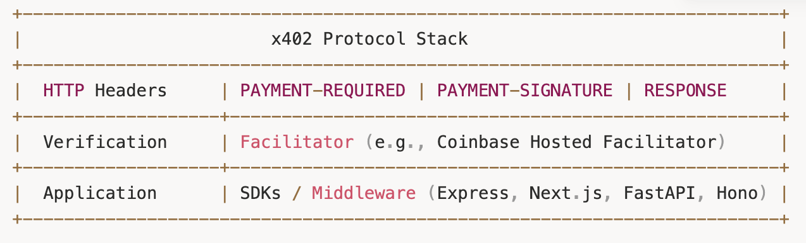
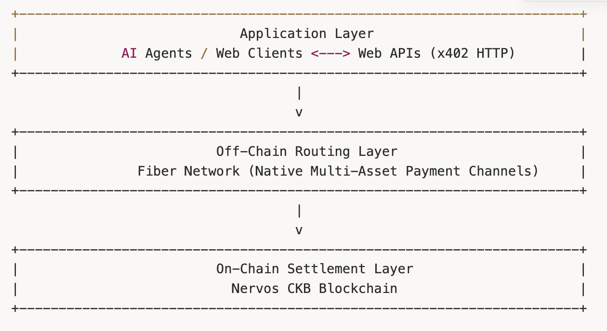

万维网的早期设计者曾设想，信息与价值应当能够同样便捷地在互联网上流动。20 世纪 90 年代制定 Web 核心通信协议标准时，[蒂姆·伯纳斯-李（Tim Berners-Lee）](https://en.wikipedia.org/wiki/Tim_Berners-Lee)等奠基者明确预留了一个 HTTP 状态码，用于原生数字购买。但由于当时不存在通用、软件原生的货币，这一愿景被搁置了。

此后，Web 发展为一个信息网络，依靠外部金融解决办法处理数字交易：广告、订阅、信用卡网关和第三方支付处理商。虽然这种架构支撑了三十年由人类驱动的电子商务，但随着人工智能从被动生成文本转向能够自主决策的软件，它正面临根本性的瓶颈。

为了让自主软件能够按需购买、出售资源并协商交易，开发者正在重建 Web 缺失的支付层。x402 协议为机器间商业（machine-to-machine commerce）提供了标准化、无状态的机制，将静态 Web 请求转变为即时数字交易。

## HTTP 402 状态码是什么？

浏览器和服务器使用 HTTP（超文本传输协议）通信。这套基础规则规定了如何在 Web 上请求和传送数据。每个请求都会返回一个三位数状态码，常见的如表示请求成功的“200 Status OK”和表示资源不存在的“404 Not Found”。为表达付款要求，HTTP 标准还包含“402 Payment Required”状态码。这是一种客户端错误响应，表示必须先付款，才能获取所请求的内容。

传统法币银行业务要求身份验证、银行账户和中心化授权，因此 Web 开发者最初无法实现通用的 402 标准。结果，Web 没有采用互联网原生货币，而是默认使用第三方支付处理商。

这种框架对人类用户尚能胜任，因为人可以手动输入信用卡号或完成 CAPTCHA 验证。但它不适用于自主软件。互联网正从人类用户转向自动程序。AI 智能体（AI agent）是一种代表用户执行任务、作出决策的自主软件系统。如果一个智能体在凌晨 3 点需要访问某个专业数据集，它无法填写注册表、同意包月合同、输入 CVV 码，也无法完成 CAPTCHA。它需要的是，以不到一秒就获得最终性的速度，快速、频繁地支付不足一美分的金额。

这一需求催生了 x402 协议。

## 什么是 x402 协议？

**x402 协议**是一项开放支付标准，利用 HTTP 402 状态码，使 AI 智能体和软件能够在无人干预的情况下，即时完成链上稳定币支付。

传统在线结账流程类似商业赊账，需要注册、身份验证和账户维护。x402 协议则像自动售货机：服务器报出价格，软件客户端投入数字支付凭证，资源就会立即交付，无需注册、保存此前交互记录或建立用户账户。

两项结构特性使这一协议特别适合现代 Web 架构：

**无状态性：** 无状态（stateless）协议将每个请求视为独立、自包含的交易。对 x402 而言，这意味着服务器无需维护活跃用户会话、数据库登录信息或订阅表，就能授予访问权限。这正是自主软件所需要的。

**HTTP 原生：** 这项标准在网络协议层面运行。由于 x402 直接建立在标准 HTTP 标头之上，任何服务器、API 网关或 CDN 都能原生检查支付挑战。CDN 即内容分发网络，是一组分布在不同地理位置、通过缓存 Web 内容来降低延迟的服务器。

x402 在协议层面运行，因此需要开放治理。2025 年底，Coinbase 和 Cloudflare [宣布](https://www.coinbase.com/en-sg/blog/coinbase-and-cloudflare-will-launch-x402-foundation)计划成立 x402 基金会，将该协议作为开放规范进行治理，避免供应商锁定。

## AI 智能体如何付款？

### 区块链与稳定币在 AI 支付中的作用

要让 AI 原生支付在全球范围内达到互联网规模，自主软件需要两种不同的技术基础：公有区块链作为可编程的执行网络，稳定币作为可预测的记账单位。

公有区块链为非人类参与者提供了所需的开放、无需许可（permissionless）的结算基础设施。传统银行网络依赖人的身份验证、法律合同，以及按本地营业时间运行的清算系统。公有区块链将智能体的身份和支出权限锚定于密码学公私钥对，从而消除了这些要求，让软件能够自主签署交易。

早期加密货币虽然提供了所需的执行网络，但不与其他资产挂钩的币种因价格波动，带来了严重阻碍。一个将每次 API 调用定价为 0.001 美元的服务商，无法接受价值每秒剧烈变化的非锚定代币。稳定币解决了这一问题：它们是通过将汇率锚定于美元等外部参照物，来保持价值稳定的加密资产。稳定币将传统法币可预测的定价，与公有区块链全天候、可编程的执行相结合。自主 AI 智能体在用户设定的程序化预算限制下执行工作流，锚定资产使它们能够准确计算微额支出，而无需承担币值突发滑点导致预算超支的风险。

将公有区块链全天候、可编程的执行能力与稳定币在经济层面的可预测性结合后，软件智能体就能通过嵌入式钱包，直接向资源提供者构建、签署并发送付款。

这一机制使机器间商业成为可能，让软件能够动态购买并组合专业微服务。

### 转向微支付

微支付（micropayments）指金额不足一美分的金融交易，这样的金额过小，在传统信用卡网络上不具备经济可行性。

在传统支付网络上，一笔 0.02 美元的交易无法成立，因为信用卡的固定处理费，通常是 0.30 美元另加 2.9%，已经超过交易总额。借助低成本区块链结算层，稳定币支付可以将交易开销降至不足一美分，让数字资源能够按单次请求、单个 token 或带宽单位计费。

*关于自主支付的更全面讨论，参见：[《AI 智能体如何付款？机器间支付指南》](https://www.nervos.org/knowledge-base/how_do_ai_agents_pay_for_things)。*

## 一笔 x402 支付如何完成？

客户端与服务器之间的执行循环通常包含六个步骤：

1. **发起请求**：客户端，即 AI 智能体或应用，向服务器上受保护的端点发送标准 HTTP GET 或 POST 请求。  
2. **返回 402 响应**：服务器的 x402 中间件拦截请求。中间件是连接服务器核心功能与 Web 应用的专用软件。它发现请求未提供支付凭证，便暂停执行并返回 HTTP 402 Payment Required 状态码。 
3. **提供付款说明**：服务器在响应标头中附上结构化付款要求，例如费用、接受的稳定币网络、目标钱包地址，以及唯一的密码学挑战 nonce 值。  
4. **签署交易**：AI 智能体接收 402 响应，解析付款说明，确认价格在其预设支出阈值以内，构建相应的区块链交易，并用私钥签名。  
5. **携凭证重试**：智能体立即重新发送原始 HTTP 请求，并添加一个授权标头，其中包含已签名的交易载荷或密码学支付凭证。  
6. **验证并控制访问**：服务器验证密码学凭证，执行原始请求，并返回 HTTP 200 OK 响应及所请求的数据。

为清晰地实现这一生命周期，x402 生态依赖一些特定组件：

**HTTP 标头**：HTTP 标头是一种元数据组件，为 Web 请求或响应提供必要背景。协议规范定义了用于管理握手过程的标准化标头。服务器通过付款要求标头说明条件，客户端在签名标头中提交已签名的凭证，服务器则用响应标头确认最终结算。

**支付协助服务（facilitators）**：Facilitator 是一种中间服务实体，代表卖方验证密码学交易凭证并完成支付结算。它将区块链执行过程从 Web 应用逻辑中抽象出来。

**SDK 与中间件**：它们提供预先构建的代码库，用于将 x402 支付集成到现有 Web 服务器中。它们充当 Web 服务器的连接层，拦截 HTTP 请求，并为端点设置价格和收款地址，要求付款后才能访问。

## Fiber 与 x402：扩展机器间商业

x402 协议标准化了 Web 服务器如何通过 HTTP 请求并验证付款，但如果每一笔微额交易都在区块链上执行，就会受到延迟和 gas 成本的限制。对于高频、持续的机器间商业，链下结算层是一种重要方案，能够提供近乎即时的交易处理能力。

Fiber Network 是建立在 Nervos CKB 区块链上的支付通道网络，旨在为未来的微支付、流式支付（streaming payments）和机器间商业提供底层基础设施。它采用支付通道（payment channels）这一链下交易机制，允许双方进行多次转账，而无需将每一笔交易都提交到区块链。

这张图展示了 Fiber 上机器间支付技术栈的三层架构：AI 智能体在应用层通过 x402 HTTP 协商价格，Fiber Network 在链下路由层即时处理稳定币支付，Nervos CKB 区块链则在链上结算层确保安全的密码学最终性。

### 实际应用与研究探索

为评估支付通道如何支持自主软件，Fiber 团队开展了一些将 Fiber Network 与 AI 工作负载结合的早期实验。

在最近的一次演示中，客户端应用直接通过浏览器，调用托管于不同机器上的自主代码生成模型。这借助了 [fiber-pay](https://github.com/RetricSu/fiber-pay)，一种面向机器使用的 CLI 工具，经过配置后可将本地 AI 智能体作为付费 HTTP 服务对外提供。平台没有收取固定月费，也没有要求用户建立计费账户，而是按每次 API 调用计量算力消耗。微支付金额通过 Fiber 支付通道在链下流转，以可忽略不计的费用在毫秒内完成结算。

在协议层面，Fiber 团队一直在[设计](https://github.com/nervosnetwork/fiber/issues/1255#7-token-delegation-macaroon-vs-biscuit)一套双轨方案，让支付通道与 Web 标准无缝集成。

**x402 facilitator 集成：** 设计探索和实验代码，例如 [x402 facilitator MVP 原型](https://github.com/nervosnetwork/fiber/pull/1301)，展示了 Fiber 如何作为更广泛 x402 生态的支付后端。这种集成使网络能够直接接入新兴的 HTTP 原生支付标准。

**Fiber 原生智能体协议：** 这一方案采用 [L402](https://www.nervos.org/knowledge-base/introduction_to_l402)（闪电网络原生支付协议）的框架，同时引入不同的架构创新。通过升级令牌系统、嵌入公平交换机制，并增加多资产支持，包括原生 CKB 代币、稳定币和用户自定义代币，这一路线将商业能力扩展到远超仅支持比特币的网络所能提供的范围。

这些早期架构设计共同奠定了基础，使支付通道节点能够成为 AI 智能体稳健、尽量减少对信任依赖（trust-minimized）的金融后端。

## 结语

开发者正在重新激活长期闲置的 HTTP 402 Payment Required 状态码，为 Web 建立开放、可编程的金融层。x402 协议、AI 智能体与 Fiber Network 等高性能结算层的结合，代表着 Web 架构的一次根本转变。互联网正在超越由人类用户手动处理订阅的封闭生态，为全球机器间经济铺平道路。
